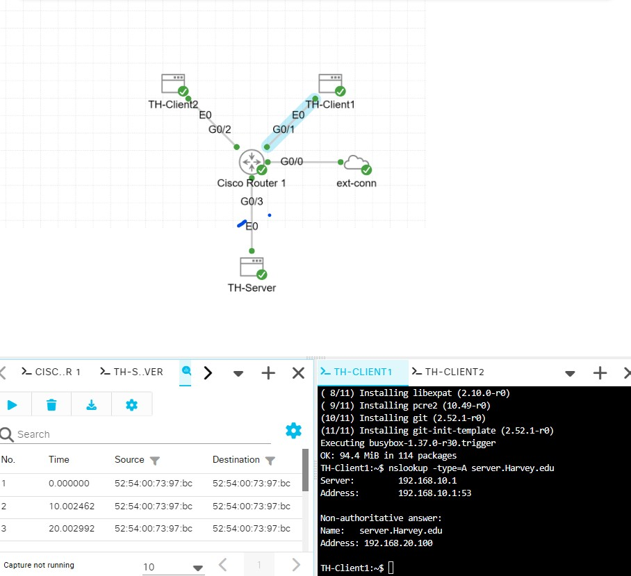
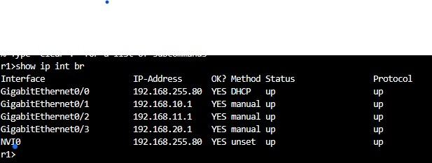
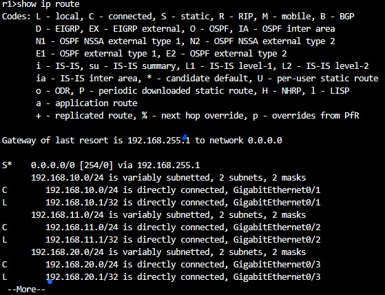
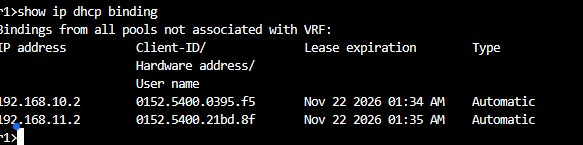
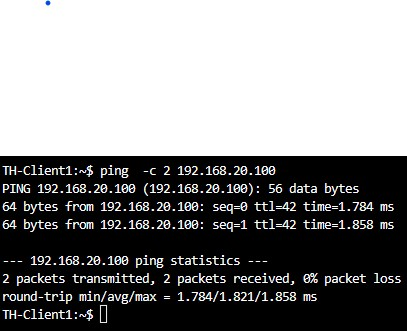
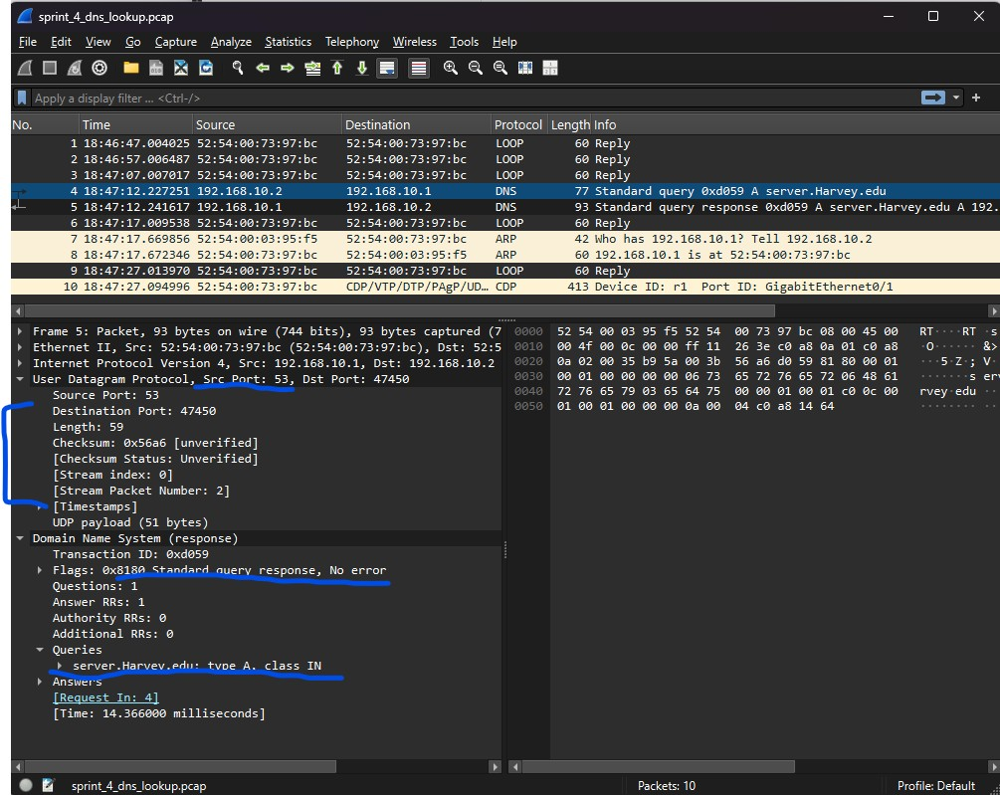

# Sprint 4: Network Infrastructure Report

**Project:** Battleship with Money (CS 457)
**Platform:** Cisco Modeling Labs (CML), one Cisco IOSv router with three subnets
**Game server hostname:** `server.Harvey.edu` → `192.168.20.100`

---
s
## 1. Network Topology



| Node | Role | Router interface | Subnet | IP address |
|------|------|------------------|--------|------------|
| TH-Client1 | Game client 1 | `Gi0/1` (192.168.10.1) | 192.168.10.0/24 | DHCP lease |
| TH-Client2 | Game client 2 | `Gi0/2` (192.168.11.1) | 192.168.11.0/24 | DHCP lease |
| TH-Server | Game server | `Gi0/3` (192.168.20.1) | 192.16s8.20.0/24 | Static `192.168.20.100` |
| ext-conn | External Connector (NAT) | `Gi0/0` (192.168.255.80, via DHCP) | CML NAT bridge | n/a |
| Cisco Router 1 (R1) | Gateway, DHCP and DNS server | all of the above | n/a | n/a |

---

## 2. Router Interfaces

`show ip interface brief` confirms every interface is `up/up` with the addresses in the table above.



---

## 3. Routing Table

`show ip route` lists the three directly connected game subnets plus the default route (`S* 0.0.0.0/0 via 192.168.255.1`) pointing out `Gi0/0` to the External Connector.



---

## 4. DHCP Leases

R1 hands out addresses to both clients from its two DHCP pools. `show ip dhcp binding` shows the active leases.



---

## 5. Connectivity Test

TH-Client1 (`192.168.10.x`) pings the game server at `192.168.20.100` with 0% packet loss, showing that R1 routes traffic between the client and server subnets.



---

## 6. DNS Resolution

R1 acts as the authoritative DNS server (`ip dns server` plus `ip host server.Harvey.edu 192.168.20.100`). From Client 1:

```
nslookup -type=A server.Harvey.edu
```



---

## 7. Wireshark DNS Capture

**File:** [`sprint_4_dns_lookup.pcap`](/sprint_4_dns_lookup.pcap)
**Captured on:** the TH-Client1 ↔ R1 link (`E0` ↔ `Gi0/1`)

| # | Source | Destination | Protocol | Info |
|---|--------|-------------|----------|------|
| 1 | 192.168.10.2 (Client 1) | 192.168.10.1 (R1) | DNS (UDP 53) | Standard query, A `server.Harvey.edu` |
| 2 | 192.168.10.1 (R1) | 192.168.10.2 (Client 1) | DNS (UDP 53) | Standard query response, A `192.168.20.100` |

The client sends a **DNS Standard Query** over UDP port 53 to its DHCP-assigned DNS server, R1. R1 answers with a **Standard Query Response** containing the A record `192.168.20.100`, the game server's static IP. The capture also includes the ARP exchange where Client 1 learns R1's MAC address before sending the query.

To view it, open the file in Wireshark and apply the display filter `dns`.

---

## 8. Running the Game Over the Lab Network

```bash
# On TH-Server
cd CS-457-Project-BattleShip-With-Money/BattleShip
python3 server.py -p 5000

# On TH-Client1 and TH-Client2
python3 client.py -i server.Harvey.edu -p 5000
```

//note to who ever reads this, I found and put together all required infomation and deliverables. Grok just helped me with the formatting